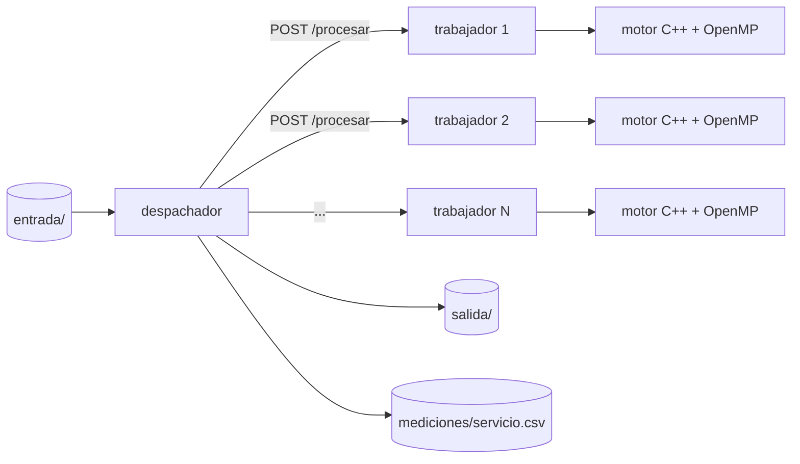

# Arquitectura del servicio

El servicio tiene tres piezas con responsabilidades separadas: el **motor** en
C++ hace todo el cómputo de imágenes, el **trabajador** lo expone por HTTP sin
implementar filtros y el **despachador** reparte el lote y es el único que toca
el almacenamiento compartido.



La regla de oro es que **solo el despachador monta `entrada/`, `salida/` y
`mediciones/`**. Los trabajadores reciben la imagen por el cuerpo de la
petición y la devuelven por el cuerpo de la respuesta; no leen ni escriben
archivos del lote. Así el lote no depende de que todos los contenedores
compartan un volumen, y escalar trabajadores no multiplica los accesos al
disco.

## 1. El motor

El motor es el binario `motor` que se compila en `motor/`. Toda la lógica de
filtros está en C++ y no se duplica en Python:

- recibe una cadena de filtros separados por comas y una imagen PPM/PGM;
- aplica la cadena en orden y escribe la imagen resultante;
- cada filtro tiene versión secuencial y versión OpenMP;
- `--secuencial` fuerza la versión de un hilo, útil para verificar que las dos
  versiones producen los mismos bytes;
- `--salud` imprime `motor ok hilos=N` y termina con código 0. El trabajador
  lo usa en `/readyz` para comprobar que el binario arranca y que OpenMP
  responde.

Para el servicio se añadió el modo de **entrada y salida estándar**:

```console
$ cat entrada.ppm | ./motor gris,gaussiano,sobel,otsu - - > salida.pgm
```

Con `-` en la entrada y en la salida, el motor lee de `stdin` y escribe en
`stdout`. Es lo que permite que el trabajador sea una capa fina: no necesita
archivos temporales, no necesita un volumen y no puede dejar basura en el
contenedor. La lectura y la escritura de PPM/PGM están en
`motor/src/imagen.cpp` (`leer_flujo` y `escribir_flujo`).

La cadena por defecto del servicio es `gris,gaussiano,sobel,otsu`: entra un
PPM de color y sale un PGM binario. Los detalles de los filtros, las tablas
$T(p)$, $S(p)$ y $E(p)$ y la optimización de localidad están en
[02-motor.md](./02-motor.md).

## 2. El trabajador

El trabajador está en `trabajador/app.py` y usa solo la biblioteca estándar de
Python: `http.server.ThreadingHTTPServer` para atender peticiones y
`subprocess` para ejecutar el motor. No usa Flask, no usa `requests` y no
importa ninguna biblioteca de procesamiento de imágenes.

### 2.1 Contrato HTTP

| Método y ruta | Cuerpo | Respuesta | Cabeceras |
|---|---|---|---|
| `POST /procesar?filtros=...` | PPM o PGM binario | Imagen procesada (`Content-Type: application/octet-stream`) | `X-Tiempo-Ms`, `X-Hilos`, `X-Filtros` |
| `GET /healthz` | — | `200 ok` | — |
| `GET /readyz` | — | `200 listo hilos=N` si el motor responde; `503` si no | `X-Hilos` |
| Otros métodos o rutas | — | `404` si la ruta no existe, `501` si el método no está implementado | — |

- Si la petición no trae `?filtros=`, se usa `FILTROS_POR_DEFECTO`.
- `X-Tiempo-Ms` es el tiempo de pared dentro del motor, sin contar la espera
  por un turno ni la lectura del cuerpo. Se escribe con tres decimales.
- `X-Hilos` es el número de hilos de OpenMP que reportó `motor --salud` al
  arrancar el trabajador.
- `X-Filtros` repite la cadena aplicada, para que el cliente pueda registrar
  qué se ejecutó.

Ejemplo con `curl` (en el entorno de desarrollo no está instalado, pero el
contrato es el mismo que usa el despachador):

```console
$ curl -sS -D - --data-binary @entrada.ppm \
    'http://trabajador:8000/procesar?filtros=gris,gaussiano,sobel,otsu' \
    -o salida.pgm
HTTP/1.1 200 OK
Content-Type: application/octet-stream
X-Tiempo-Ms: 12.345
X-Hilos: 2
X-Filtros: gris,gaussiano,sobel,otsu
```

### 2.2 Códigos de error

| Código | Cuándo |
|---:|---|
| `400` | El motor rechaza la petición: filtro desconocido, cadena que no se puede aplicar o imagen inválida. |
| `411` | Falta `Content-Length`. |
| `413` | El cuerpo supera `TAMANO_MAXIMO` (64 MiB por defecto). |
| `503` | El trabajador está ocupado y no consigue un turno, o `/readyz` no puede ejecutar el motor. |
| `504` | El motor excede `TIEMPO_MAXIMO`. |
| `500` | No se puede ejecutar el motor o termina de forma anormal. |

El trabajador no decide qué filtros existen: se lo pregunta al motor. Si el
motor devuelve un error de validación, el trabajador lo traduce a `400` y
devuelve el mensaje del motor. Así la lista de filtros válidos vive en un solo
sitio, el C++.

### 2.3 Concurrencia y control de carga

`ThreadingHTTPServer` atiende varias peticiones a la vez, pero cada una lanza un
proceso `motor` que usa OpenMP. Para no crear más procesos de los que el
contenedor puede sostener, el trabajador tiene un semáforo con
`MAXIMO_EN_VUELO` turnos:

```text
peticiones HTTP concurrentes
        │
        ▼
  semáforo MAXIMO_EN_VUELO
        │
        ▼
  un proceso motor por petición
        │
        ▼
  OMP_NUM_THREADS hilos por proceso
```

El producto `MAXIMO_EN_VUELO × OMP_NUM_THREADS` es la cantidad de hilos que un
trabajador puede ocupar. En Compose se usa `MAXIMO_EN_VUELO=2` y
`OMP_NUM_THREADS=1`. En Kubernetes se usa `MAXIMO_EN_VUELO=1` y
`OMP_NUM_THREADS=2`, porque el contenedor tiene un límite de CPU más ajustado.
Las dos combinaciones usan dos hilos por trabajador y evitan que el
planificador del sistema operativo tenga que repartir decenas de procesos.

`MAXIMO_EN_VUELO` no es un límite de peticiones TCP: las conexiones que esperan
turno quedan vivas y el cliente recibe la respuesta cuando les toca. Si la
espera supera `TIEMPO_ESPERA` (30 s por defecto), el trabajador responde `503`
para que el despachador reintente en otro trabajador.

### 2.4 Sin estado y sin disco

El trabajador no guarda nada entre peticiones:

- no escribe archivos: la imagen entra por `stdin` del motor y sale por
  `stdout`;
- no usa el volumen del lote;
- no cachea resultados;
- cualquier trabajador puede atender cualquier imagen.

Eso es lo que hace que un Service de Kubernetes pueda repartir peticiones sin
afinidad y que Compose pueda escalar horizontalmente sin cambiar el
despachador.

## 3. El despachador

El despachador está en `despachador/despachador.py` y también usa solo la
biblioteca estándar: `concurrent.futures.ThreadPoolExecutor` para tener varias
peticiones en vuelo, `http.client` para hablar con los trabajadores y `csv`
para el registro.

### 3.1 Flujo del lote

1. Lee los archivos `.ppm` de `ENTRADA` en orden alfabético.
2. Si no hay ninguno, genera el lote con el binario C++ `generar`. Por defecto
   son 64 imágenes de 1024x1024; la semilla de cada imagen cambia el patrón
   para que no sean idénticas. La generación no se cuenta en el tiempo del
   pipeline.
3. Resuelve el nombre del servicio de trabajadores a una o varias URLs.
4. Envía las imágenes con un grupo de `CONCURRENCIA` hilos. Cada petición
   lleva `Content-Type: application/octet-stream`, `Content-Length` y
   `Connection: close`.
5. Recibe la imagen procesada, decide la extensión por la cabecera (`P6` →
   `.ppm`, `P5` → `.pgm`) y la escribe en `SALIDA` con el mismo nombre base.
6. Mide el tiempo de pared desde que empieza a enviar hasta que termina de
   escribir todas las salidas, y añade una fila a `CSV_SERVICIO`:

   ```csv
   entorno,trabajadores,concurrencia,imagenes,segundos
   local,4,8,64,0.443
   ```

El CSV se abre en modo append; si no existe, escribe la cabecera. El
despachador imprime además la fila y el throughput en su salida estándar, para
que `kubectl logs` sea suficiente aunque no se pueda copiar el PVC.

### 3.2 Reparto entre trabajadores

El despachador no habla con un trabajador concreto: recibe una lista de URLs y
las recorre en orden circular con un candado. La lista se construye de dos
formas:

- **Compose:** el nombre `trabajador` resuelve a las IPs de todas las réplicas.
  El despachador llama a `socket.getaddrinfo` y arma una URL por IP. Con
  `--scale trabajador=4` hay cuatro IPs y el reparto es explícito.
- **Kubernetes:** el Service `trabajador` es de tipo `ClusterIP`, así que el
  nombre resuelve a una sola IP virtual. kube-proxy reparte las conexiones
  entre los pods. Para que el reparto no quede pegado a una conexión larga, el
  despachador pide `Connection: close`; cada petición es una conexión nueva.

La lista se puede forzar con `TRABAJADOR_URLS` (separada por comas). Es lo que
usan las pruebas locales sin Docker, donde no hay un DNS de Compose:

```console
$ TRABAJADOR_URLS=http://127.0.0.1:18011,http://127.0.0.1:18012 \
    python3 despachador/despachador.py
```

En la configuración normal no hace falta: `TRABAJADOR_URL` vale
`http://trabajador:8000`, que es el nombre que usan Compose y Kubernetes.

### 3.3 Tolerancia a fallos

- Los errores `4xx` no se reintentan: un filtro desconocido o una imagen
  inválida no se arreglan repitiendo.
- Los errores de conexión y los `5xx` se reintentan hasta `REINTENTOS` veces
  con espera exponencial acotada a 2 s. Cada reintento elige la siguiente URL.
- Antes de empezar a enviar, el despachador espera a que el nombre del servicio
  resuelva. Si los trabajadores aún no están listos, la espera se reintenta.
- Si una imagen falla definitivamente, el despachador informa el error, no
  escribe el CSV de esa corrida y termina con código 1. El Job de Kubernetes
  lo marca como fallido y `aplicar.sh` muestra los logs.

### 3.4 Por qué el despachador es el único con volúmenes

El despachador lee el lote, genera el lote si hace falta, escribe las salidas y
agrega el CSV. Es el único que necesita el volumen. Los trabajadores no lo
montan, y esa es la garantía de que no hay dos procesos escribiendo el mismo
archivo ni un trabajador leyendo una imagen a medio escribir.

En Compose el despachador corre con el UID/GID del usuario local
(`user: "${UID:-1000}:${GID:-1000}"`) para que los archivos de los bind mounts
queden con el dueño correcto. En Kubernetes el Job usa `runAsUser: 1000` y
`fsGroup: 1000` sobre el PVC, para no correr como root. El trabajador corre
siempre con un UID no privilegiado y con el sistema de archivos de solo
lectura.

## 4. Elección de tecnologías

| Pieza | Tecnología | Motivo |
|---|---|---|
| Cómputo | C++17 + OpenMP | Es el requisito del proyecto y permite medir $T(p)$, $S(p)$ y $E(p)$ sin la sobrecarga de un intérprete. |
| Trabajador | Python 3 + `http.server` | La capa HTTP es delgada; no necesita framework ni dependencias externas. |
| Despachador | Python 3 + `concurrent.futures` + `http.client` | Permite tener varias peticiones en vuelo y controlar el reparto con la biblioteca estándar. |
| Empaquetado | Docker multi-stage | El motor se compila en una etapa con `gcc` y la imagen final solo lleva el binario, Python y `libgomp1`. |
| Local | Docker Compose | Un comando levanta trabajadores y despachador; `--scale` cambia el número de réplicas. |
| Nube | Kubernetes/GKE | Deployment con 3 réplicas, Service ClusterIP, ConfigMap, PVC y Job. |

## 5. Configuración compartida

Los mismos nombres de variable se usan en Compose y en Kubernetes:

| Variable | Quién la lee | Efecto |
|---|---|---|
| `OMP_NUM_THREADS` | motor (OpenMP) | Hilos por proceso. |
| `MAXIMO_EN_VUELO` | trabajador | Procesos `motor` simultáneos por trabajador. |
| `FILTROS_POR_DEFECTO` / `FILTROS` | trabajador / despachador | Cadena de filtros. |
| `CONCURRENCIA` | despachador | Peticiones en vuelo. |
| `IMAGENES`, `ANCHO`, `ALTO` | despachador | Lote a generar si la entrada está vacía. |
| `TRABAJADOR_URL` / `TRABAJADOR_URLS` | despachador | Destino del reparto. |
| `TRABAJADORES` | despachador | Número de réplicas para la fila del CSV. |
| `ENTRADA`, `SALIDA`, `CSV_SERVICIO` | despachador | Rutas del almacenamiento. |

El detalle de los valores usados en cada entorno y las instrucciones de
ejecución están en [03-despliegue.md](./03-despliegue.md).
