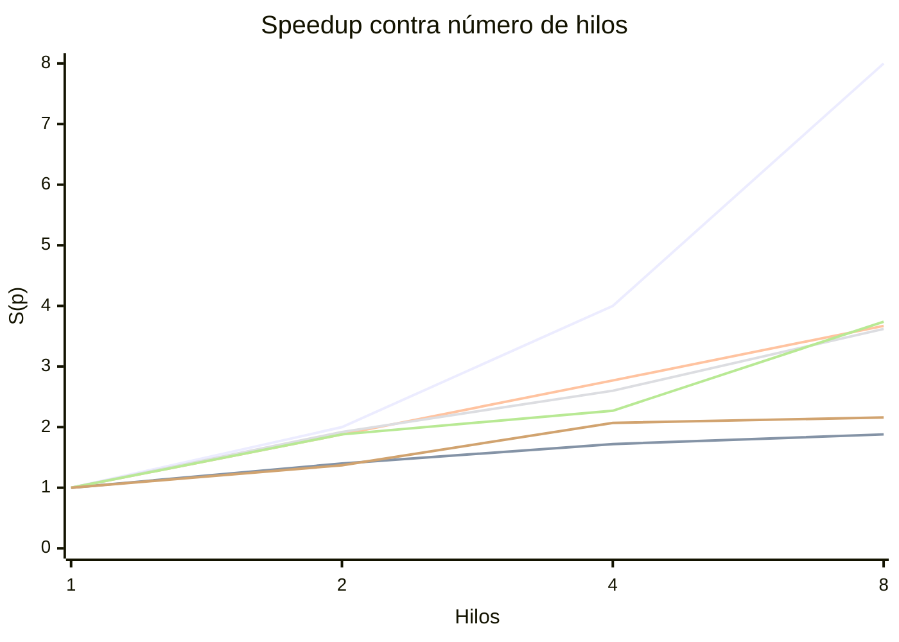

# El motor: filtros, paralelización y mediciones

El motor está en `motor/`. Cada filtro existe en versión secuencial y en
versión OpenMP, y las dos producen la misma salida byte a byte. Este archivo
recoge cómo quedó implementado cada filtro nuevo, la estrategia de
paralelización, la metodología de medición, las tablas de $T(p)$, $S(p)$ y
$E(p)$ para $p \in \{1,2,4,8\}$, la comparación del gaussiano separable contra
la forma directa, la del histograma privado contra el compartido y la
optimización de localidad con su medición antes y después.

## 1. Los filtros

Las convenciones del enunciado valen para todos: los bordes se resuelven
repitiendo el píxel más cercano (`recortar()` en `motor/src/imagen.hpp`), las
sumas ponderadas se acumulan en `double`, y el entero de salida se redondea al
más cercano con los empates hacia arriba y se satura a $[0,255]$
(`redondear()`).

### 1.1 Escala de grises y desenfoque de caja

Vienen resueltos en el repositorio base. Son la línea base de un `map` y de un
`stencil`, y se conservaron como estaban.

### 1.2 Desenfoque gaussiano separable

Se usa el núcleo binomial de 5 elementos

$$
k = \frac{1}{16}\,[1,4,6,4,1],
$$

en dos pasadas: primero horizontal sobre la entrada y después vertical sobre
el intermedio,

$$
T(x,y)=\sum_{i=-2}^{2} k_{i+2}\,I(x+i,y),
\qquad
O(x,y)=\operatorname{round}\!\left(\sum_{j=-2}^{2} k_{j+2}\,T(x,y+j)\right).
$$

La forma directa de $5\times5$ cuesta 25 multiplicaciones por píxel; la
separable cuesta 10. El intermedio $T$ se guarda en `double` y no se redondea,
así que la separable y la directa producen exactamente los mismos bytes. Está
en `gaussiano_secuencial`, `gaussiano_paralelo` y `gaussiano_directo_secuencial`
(`motor/src/filtros.cpp`).

### 1.3 Sobel con magnitud del gradiente

Las dos máscaras de $3\times3$

$$
G_x=\begin{bmatrix}-1&0&1\\-2&0&2\\-1&0&1\end{bmatrix},
\qquad
G_y=\begin{bmatrix}-1&-2&-1\\0&0&0\\1&2&1\end{bmatrix}
$$

se evalúan en un solo recorrido de la vecindad: se leen los nueve vecinos una
vez y de ellos salen $g_x$ y $g_y$. La salida es

$$
O(x,y)=\min\!\left(255,\operatorname{round}\!\left(\sqrt{g_x^2+g_y^2}\right)\right).
$$

Leer la vecindad una sola vez ahorra la mitad de los accesos frente a aplicar
las dos máscaras en pasadas separadas. Está en `sobel_secuencial` y
`sobel_paralelo`.

### 1.4 Histograma, ecualización y umbral de Otsu

El histograma $h(v)$ cuenta los píxeles de cada nivel $v\in[0,255]$. La
ecualización usa el acumulado $c(v)=\sum_{u\le v}h(u)$, el primer acumulado
distinto de cero $c_{\min}$ y el total $N=W\cdot H$:

$$
O(x,y)=\operatorname{round}\!\left(
\frac{c(I(x,y))-c_{\min}}{N-c_{\min}}\cdot 255
\right).
$$

Otsu recorre los 255 umbrales y se queda con el que maximiza la varianza entre
clases

$$
\sigma_B^2(t)=\omega_0(t)\,\omega_1(t)\,\bigl(\mu_0(t)-\mu_1(t)\bigr)^2,
\qquad
t^*=\arg\max_{0\le t<255}\sigma_B^2(t),
$$

con $\omega_0(t)=\sum_{v\le t}h(v)/N$, $\omega_1=1-\omega_0$ y $\mu_0,\mu_1$
las medias de cada clase. La salida es binaria: 0 si $I(x,y)\le t^*$ y 255 en
otro caso. Está en `histograma_*`, `umbral_otsu`, `ecualizar_*` y `otsu_*`.

### 1.5 La cadena del lote

`gris → gaussiano separable → Sobel → umbral de Otsu`, siempre en ese orden.
Entra un PPM de color y sale un PGM binario. La cadena completa también tiene
versión secuencial y paralela, y las dos son idénticas byte a byte.

## 2. Paralelización con OpenMP

| Filtro | Patrón | Directiva | Reparto |
|---|---|---|---|
| `gaussiano` (ambas pasadas) | stencil | `#pragma omp parallel for schedule(static)` | filas |
| `gaussiano_bloques` | stencil fusionado | `#pragma omp parallel` + `for` sobre bloques | bloques de filas |
| `sobel` | stencil | `#pragma omp parallel for schedule(static)` | filas |
| `histograma` | reducción | `#pragma omp parallel` + histograma privado por hilo | filas |
| `otsu` | reducción + barrido | histograma paralelo + barrido secuencial + binarizado paralelo | filas |
| `ecualizar` | reducción + `map` | histograma paralelo + tabla secuencial + aplicación paralela | filas |

El reparto va sobre las **filas** y no sobre las columnas porque la imagen está
guardada por filas: una banda de filas es un bloque contiguo de memoria,
mientras que avanzar por columnas en el ciclo interno toca una línea de caché
nueva en cada paso. Con `schedule(static)` cada hilo recibe una banda contigua
y el costo por fila es uniforme, así que no hace falta balanceo dinámico.

El histograma no se puede acumular en un arreglo compartido protegido con
`atomic` sin serializar el recorrido. La versión que se usa en el motor le da
un histograma privado a cada hilo, con 8 contadores de relleno entre uno y otro
para que no compartan línea de caché, y los suma al final con un `for`
paralelo. La versión con `atomic` sobre un solo arreglo (`otsu_compartido`) se
conserva solo para medir la diferencia; sus resultados están en la sección 7.

El barrido de los 255 umbrales de Otsu se deja secuencial: son 255 iteraciones
frente a los $4096^2=16\,777\,216$ píxeles del histograma, así que su peso en
el tiempo total es despreciable. La fracción secuencial que se deduce de las
mediciones está en la sección 9.

## 3. Corrección

La prueba de corrección es el comparador byte a byte del repositorio
(`motor/tests/comparar.cpp`). `make pruebas` verifica:

- las salidas esperadas de `tests/datos/` para gris, caja, gaussiano, Sobel,
  Otsu y ecualización;
- que la versión paralela sea idéntica a la secuencial para todos los filtros,
  con **1, 2, 4 y 8 hilos**;
- que el gaussiano por bloques, el gaussiano directo de $5\times5$ y el Otsu
  con histograma compartido coincidan con su versión de referencia, el primero
  y el último con 1 y 8 hilos;
- que la cadena completa `gris,gaussiano,sobel,otsu` sea idéntica con 1, 2, 4
  y 8 hilos.

La salida completa de la corrida está en
`mediciones/evidencias/pruebas.txt`, y la compilación con `-Wall -Wextra`
—sin avisos— en `mediciones/evidencias/compilacion.txt`.

Las salidas esperadas de `tests/datos/` se calcularon con una implementación
aparte en Python de las mismas definiciones, no con el código C++.

## 4. Metodología y máquina

Todas las cifras de este archivo salen de la misma máquina:

| Componente | Valor |
|---|---|
| Procesador | AMD Ryzen 5 4600G with Radeon Graphics |
| Núcleos físicos / hilos | 6 / 12 (2 hilos por núcleo) |
| Caché | L1d 192 KiB (6 instancias), L2 3 MiB (6 instancias), L3 4 MiB (1 instancia) |
| Memoria | 7.5 GiB disponibles en la máquina virtual |
| Compilador | g++ (Ubuntu 15.2.0-16ubuntu1) 15.2.0 |
| Sistema | Ubuntu 26.04.1 LTS sobre WSL2, kernel 6.18.58.1-microsoft-standard-WSL2 |
| Banderas | `-std=c++17 -O2 -Wall -Wextra -fopenmp` |

La metodología es la del enunciado:

- una sola imagen de $4096\times4096$ generada con `bench/generar.cpp`;
- hilos $p\in\{1,2,4,8\}$, fijados con `OMP_NUM_THREADS`;
- cinco repeticiones por configuración, se descarta la primera y se reporta la
  mediana de las cuatro restantes;
- tiempo de pared con `omp_get_wtime()` alrededor de la llamada al filtro, con
  la imagen ya en memoria y sin contar lectura ni escritura;
- los datos crudos quedan en `mediciones/motor.csv`, con las columnas
  `filtro,hilos,repeticion,milisegundos`.

Antes de la campaña registrada se hizo una pasada completa de calentamiento
que no se guardó, para que el escalado de frecuencia del procesador no quedara
dentro de las cinco repeticiones. La campaña registrada tiene las 185 filas
esperadas: $5$ filtros de color $\times 4$ hilos $\times 5$ repeticiones,
$4$ filtros de un canal $\times 4 \times 5$ y `gaussiano_directo` con un hilo
$\times 5$.

`bench/medir_completo.sh` corre la campaña y `bench/resumir.py` produce las
tablas de este archivo. El PGM de entrada de Sobel, Otsu y ecualización se
obtiene con `./motor gris medicion.ppm medicion.pgm`.

## 5. Tiempos, speedup y eficiencia

### 5.1 $T(p)$ en milisegundos

| Filtro | p=1 | p=2 | p=4 | p=8 |
|---|---:|---:|---:|---:|
| `gris` | 44.2 | 21.5 | 15.8 | 11.1 |
| `caja` | 680.4 | 414.2 | 233.6 | 161.7 |
| `gaussiano` | 558.3 | 398.9 | 325.4 | 297.7 |
| `gaussiano_bloques` | 425.1 | 225.8 | 153.2 | 115.9 |
| `gaussiano_directo` | 1580.4 | — | — | — |
| `sobel` | 64.5 | 33.6 | 24.8 | 17.8 |
| `otsu` | 18.9 | 10.1 | 8.3 | 5.0 |
| `ecualizar` | 14.9 | 8.7 | 7.1 | 4.7 |
| `otsu_compartido` | 79.9 | 58.6 | 61.5 | 54.2 |
| `cadena` | 318.6 | 231.9 | 153.7 | 147.2 |

### 5.2 $S(p)=T(1)/T(p)$

| Filtro | p=1 | p=2 | p=4 | p=8 |
|---|---:|---:|---:|---:|
| `gris` | 1.00 | 2.06 | 2.80 | 3.97 |
| `caja` | 1.00 | 1.64 | 2.91 | 4.21 |
| `gaussiano` | 1.00 | 1.40 | 1.72 | 1.88 |
| `gaussiano_bloques` | 1.00 | 1.88 | 2.77 | 3.67 |
| `gaussiano_directo` | 1.00 | — | — | — |
| `sobel` | 1.00 | 1.92 | 2.60 | 3.62 |
| `otsu` | 1.00 | 1.88 | 2.27 | 3.74 |
| `ecualizar` | 1.00 | 1.72 | 2.10 | 3.19 |
| `otsu_compartido` | 1.00 | 1.36 | 1.30 | 1.47 |
| `cadena` | 1.00 | 1.37 | 2.07 | 2.16 |

### 5.3 $E(p)=S(p)/p$

| Filtro | p=1 | p=2 | p=4 | p=8 |
|---|---:|---:|---:|---:|
| `gris` | 1.00 | 1.03 | 0.70 | 0.50 |
| `caja` | 1.00 | 0.82 | 0.73 | 0.53 |
| `gaussiano` | 1.00 | 0.70 | 0.43 | 0.23 |
| `gaussiano_bloques` | 1.00 | 0.94 | 0.69 | 0.46 |
| `gaussiano_directo` | 1.00 | — | — | — |
| `sobel` | 1.00 | 0.96 | 0.65 | 0.45 |
| `otsu` | 1.00 | 0.94 | 0.57 | 0.47 |
| `ecualizar` | 1.00 | 0.86 | 0.52 | 0.40 |
| `otsu_compartido` | 1.00 | 0.68 | 0.32 | 0.18 |
| `cadena` | 1.00 | 0.69 | 0.52 | 0.27 |

### 5.4 Lectura de las cifras

- **El gaussiano es el filtro que peor escala**: su eficiencia cae a 0.23 con
  8 hilos. La causa es la memoria, no el cómputo: el intermedio $T$ ocupa
  $4096\cdot4096\cdot3\cdot8 = 402\,653\,184$ bytes (≈384 MiB) y la pasada
  vertical lo relee cinco veces por fila. Por eso es el candidato de la
  optimización de localidad de la sección 8.
- **Sobel escala bien** (eficiencia 0.45), porque cada fila lee tres filas
  contiguas y estas caben en caché; el cuello de botella es el ancho de banda.
- **Otsu y la ecualización tienen tiempos absolutos pequeños** (5.0 y 4.7 ms
  con 8 hilos) y una eficiencia de 0.47 y 0.40. Su histograma es una reducción
  de 256 contadores y el resto es un recorrido de memoria.
- **La cadena completa** baja de 318.6 ms a 147.2 ms ($S(8)=2.16$,
  $E(8)=0.27$). Queda dominada por el gaussiano: en la cadena, el gaussiano
  aporta más de la mitad del tiempo a 8 hilos.
- `otsu_compartido` es la versión ingenua: su eficiencia es 0.18 y casi no
  mejora al agregar hilos ($S(8)=1.47$). Es la comparación de la sección 7.
- `gris` es el filtro más corto y por eso el más ruidoso: su eficiencia de
  1.03 con 2 hilos es ruido de medición, no superlinealidad real. Aun así, la
  tendencia de 1 a 8 hilos es clara.

### 5.5 Gráfica de speedup



## 6. Gaussiano separable contra la forma directa de 5x5

La comparación se hace con **un solo hilo**, porque lo que se mide es la
decisión algorítmica y no el reparto entre núcleos.

| Forma | T(1) en ms | Multiplicaciones por píxel |
|---|---:|---:|
| Directa $5\times5$ (`gaussiano_directo`) | 1580.4 | 25 |
| Separable (`gaussiano`) | 558.3 | 10 |
| Mejora | **2.83×** | 2.5× teórica |

La mejora algorítmica (2.83×) es mayor que el speedup que aportan los núcleos
en este filtro (1.88× con 8 hilos). La separable con 8 hilos (297.7 ms) sigue
siendo más rápida que la directa con un hilo (1580.4 ms), pero la decisión que
más pesa es haber factorizado el núcleo. Ambas formas dan el mismo archivo
byte a byte.

## 7. Histograma con acumulador compartido contra histogramas privados

| Hilos | `otsu` (privado + relleno) | `otsu_compartido` (`atomic`) | Veces más rápido el privado |
|---:|---:|---:|---:|
| 1 | 18.9 ms | 79.9 ms | 4.2× |
| 2 | 10.1 ms | 58.6 ms | 5.8× |
| 4 | 8.3 ms | 61.5 ms | 7.4× |
| 8 | 5.0 ms | 54.2 ms | 10.8× |

El acumulador compartido no escala: $S(8)=1.47$ y $E(8)=0.18$. Cada incremento
toma la misma línea de caché y el `atomic` serializa a los hilos; por eso el
tiempo con 4 hilos (61.5 ms) es incluso peor que con 2 (58.6 ms). Los
histogramas privados sí escalan ($S(8)=3.74$, $E(8)=0.47$). El relleno de 8
contadores (64 bytes) entre histogramas evita que el último contador de un
hilo y el primero del siguiente compartan línea, que es el false sharing que
aparecería si los arreglos privados estuvieran uno pegado al otro.

## 8. Optimización de localidad

Se elige el gaussiano porque es el filtro que peor escala de los tres nuevos:
$E(8)=0.23$, el valor más bajo de la tabla. La optimización es **recorrer la
pasada vertical por bloques de filas** en vez de sobre el arreglo intermedio
completo (`gaussiano_bloques`).

Para cada bloque de 32 filas se calcula el horizontal solo de las filas que
hacen falta (el bloque más dos de halo arriba y dos abajo) en un intermedio
privado del hilo. La pasada vertical consume ese bloque de inmediato, de modo
que el intermedio cabe en caché y no se escribe y relee la imagen entera. El
halo se recalcula: es trabajo redundante pequeño (4 filas de 32) a cambio de
no tocar memoria principal. La salida es idéntica a la separable porque el
horizontal no cambia y el vertical suma los mismos cinco valores.

### 8.1 Antes y después

| Hilos | `gaussiano` antes (ms) | `gaussiano_bloques` después (ms) | Mejora |
|---:|---:|---:|---:|
| 1 | 558.3 | 425.1 | 1.31× |
| 2 | 398.9 | 225.8 | 1.77× |
| 4 | 325.4 | 153.2 | 2.12× |
| 8 | 297.7 | 115.9 | **2.57×** |

El speedup del filtro pasa de $S(8)=1.88$ a $S(8)=3.67$, y la eficiencia de
0.23 a 0.46.

### 8.2 Qué cambió en el acceso a memoria

Antes, la pasada horizontal escribía los 384 MiB de $T$ y la vertical los
recorría cinco veces por fila: el tráfico a memoria principal era de varios
cientos de MiB por pasada. Después, cada hilo trabaja con un intermedio de
$(32+4)$ filas, es decir $36\cdot4096\cdot3\cdot8\approx3.5$ MiB, y lo consume
antes de pasar al siguiente bloque. El volumen de datos que se escribe y se
vuelve a leer baja en un factor cercano al número de bloques.

La evidencia del cambio se midió con `/usr/bin/time -v` (la misma corrida,
8 hilos, dos repeticiones):

| Versión | Tiempo de pared | Máximo RSS | Tiempo de sistema | Fallos de página menores |
|---|---:|---:|---:|---:|
| `gaussiano` | 0.76 s | 496 028 KiB (≈484 MiB) | 0.55 s | 233 659 |
| `gaussiano_bloques` | 0.28 s | 130 532 KiB (≈127 MiB) | 0.09 s | 46 497 |

El tiempo de pared de `/usr/bin/time` incluye la lectura del PPM y el arranque
del proceso, por eso no coincide con $T(8)$ del arnés; lo que se compara es el
cambio entre las dos versiones. El RSS baja a la cuarta parte (3.8× menos), los
fallos de página menores bajan 5× y el tiempo de sistema baja 6×: menos
páginas tocadas y menos presión sobre el asignador explican la mejora. El
porcentaje de CPU pasa de 274 % a 589 %, señal de que la versión por bloques
pasa menos tiempo esperando memoria.

La salida cruda de las dos corridas quedó en
`mediciones/evidencias/perfil-gaussiano.txt` y
`mediciones/evidencias/perfil-gaussiano-bloques.txt`. No se usó `perf`: no está
instalado en este entorno WSL, así que la herramienta documentada es
`/usr/bin/time -v`, que está entre las aceptadas por el enunciado.

## 9. Fracción secuencial y Ley de Amdahl

El barrido de los 255 umbrales de Otsu es la única parte que queda
deliberadamente secuencial. Comparado con el recorrido de $16\,777\,216$
píxeles, su peso es menor que 0.1 %, así que no explica la caída de
eficiencia.

Si se despeja la fracción paralelizable $f$ de $S(p)=1/((1-f)+f/p)$ con las
cifras medidas:

- gaussiano separable, $S(8)=1.88$: $f\approx0.53$; casi la mitad del tiempo
  no escala por el tráfico del intermedio de 384 MiB.
- gaussiano por bloques, $S(8)=3.67$: $f\approx0.83$, es decir, un 17 % del
  tiempo no escala. Ese 17 % es el tráfico de memoria y no el barrido de Otsu.
- Otsu con histograma privado, $S(8)=3.74$: $f\approx0.84$.
- cadena completa, $S(8)=2.16$: $f\approx0.62$; el límite lo pone el gaussiano,
  que es la etapa más costosa.

## 10. Reproducir las mediciones

```console
$ cd motor
$ make
$ make test
$ ./generar /tmp/medicion.ppm 4096 4096
$ ./motor gris /tmp/medicion.ppm /tmp/medicion.pgm
$ bash bench/medir_completo.sh /tmp/medicion.ppm /tmp/medicion.pgm /tmp/calentamiento.csv
$ bash bench/medir_completo.sh /tmp/medicion.ppm /tmp/medicion.pgm
$ python3 bench/resumir.py ../mediciones/motor.csv
```

La primera corrida de `medir_completo.sh` es el calentamiento y se descarta;
la segunda escribe `mediciones/motor.csv` con las 185 filas de la campaña. Las
imágenes de medición no se versionan y las escribe el generador.

Para repetir la evidencia del perfilador:

```console
$ OMP_NUM_THREADS=8 /usr/bin/time -v ./arnes gaussiano /tmp/medicion.ppm 2
$ OMP_NUM_THREADS=8 /usr/bin/time -v ./arnes gaussiano_bloques /tmp/medicion.ppm 2
```
